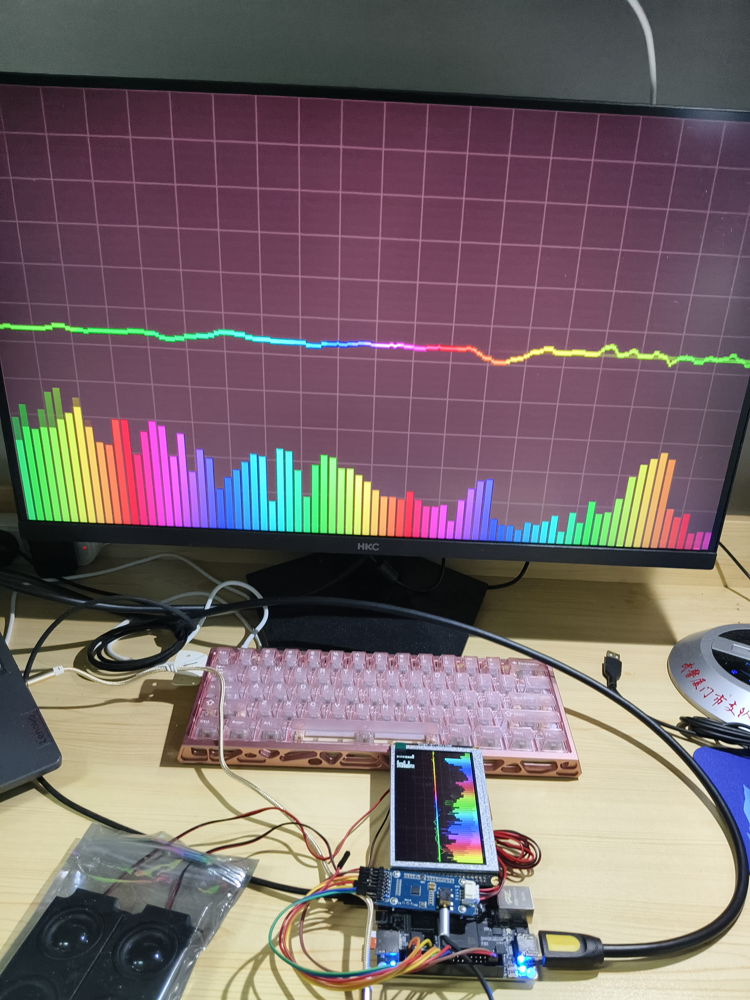
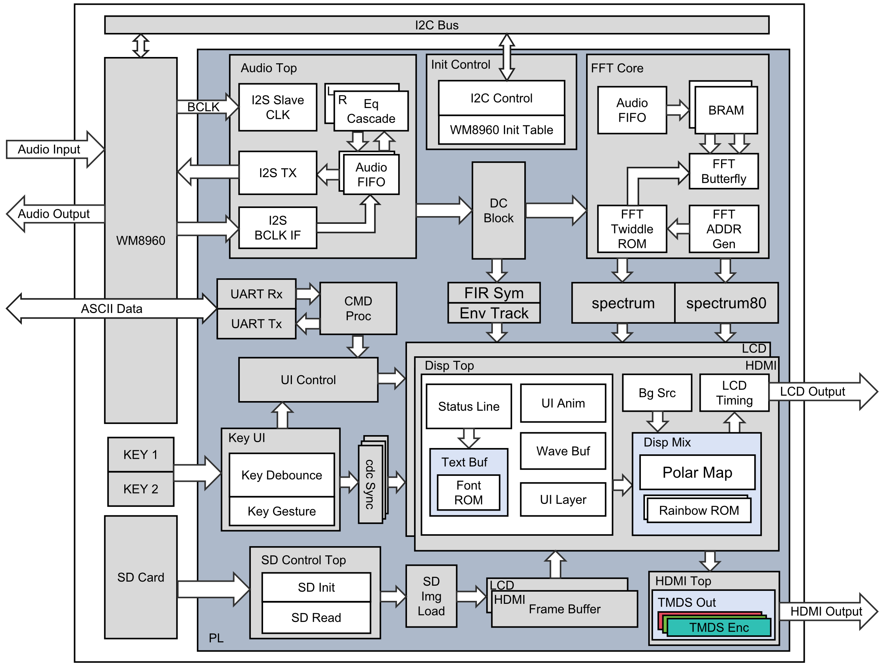

# 音速并行 Sonic-Speed-Parallelism

[](https://github.com/flyingyuya/Sonic-Speed-Parallelism/actions/workflows/rtl-ci.yml)

基于 Artix-7 (XC7A100T) 的**音频一体化系统** —— **纯 RTL 实现，不依赖 HLS 和任何现成 IP 核**。
> 关于作品的详细说明可以查看[技术设计报告](技术设计报告.pdf)。



---

## 系统架构框图



---

## 目录结构

```
Sonic-Speed-Parallelism/
├── README.md                     项目说明
├── LICENSE
├── 技术设计报告.pdf
├── rtl/                          RTL 源文件
├── constrs/                      管脚与时序约束
├── scripts/                      构建与生成脚本
│   ├── golden/                     Python 定点黄金模型 + 表生成器
│   ├── sdcard/                     图片生成和写卡
│   ├── sim/
│   │   ├── run_iv.sh                41 个 TB 并行回归（JOBS=nproc）
│   │   └── run_xsim.sh              Vivado xsim 流程
│   └── vivado/
│       ├── build.tcl                综合 / 实现 / 比特流
│       ├── program.tcl              SRAM 下载 / QSPI Flash 固化
│       ├── synth_check.tcl          单模块综合检查
│       └── sim.tcl                  xsim 仿真
│
├── sim/tb/                        40 个 testbench + 3 个行为模型
├── docs/                          设计文档、数据手册
└── .pi/skills/                    3 个技能包
    ├── fixed-point-dsp/            定点 DSP 精度预算
    ├── fpga-rtl-flow/              基于 TCL 脚本的 FPGA 设计流程
    └── rtl-verification/           RTL 自动化验证方法
```

---

## 核心设计取舍

| 取舍 | 选择 | 为什么 |
| --- | --- | --- |
| FFT 结构 | **单蝶形时分复用** | 全并行需 2048 个 DSP，器件只有 240。时分复用后只要 4 个（**1/500**），而 FFT 只占 1.05% 帧时间 |
| 均衡器 | **IIR 双二阶级联**，不用 STFT | STFT 频域均衡的**算法固有延迟 = 窗长 = 21.3 ms**，与"实时"直接矛盾。这是数学问题不是实现问题 |
| 显示 | **扫描到哪算到哪**，无 framebuffer | 参考工程用 400 行渲染状态机是因为背景图来自 SD 卡必须流式取；我们背景用组合逻辑算，不需要 |
| I2S | **FPGA 当从机** | WM8960 手册 P56：数字音频接口也从 SYSCLK 派生，MCLK 必须与 BCLK/LRCLK 同源 |
| BCLK | **过采样恢复**，不当时钟域 | 少一个时钟域、少一个 BUFG；48 MHz / 3.072 MHz = 15.6 倍，余量充足 |
| HDMI | **只做 TMDS = DVI 输出** | 板上是差分对直连（无发送芯片）→ 自己做编码；不要 CEC/音频/HDCP 大幅简化 |
| 定点格式 | 数据 Q1.23，系数 **Q2.16** | Q1.17 装不下二阶高架的 `b0 = 2.12`，实测频响误差 7 dB |
| 交互 | **按键/触摸/UART 汇到一个寄存器组** | 显示链完全不知道是谁改的；加新输入源不用动显示逻辑 |

---

## 已完成

### 音频链路

| 子系统 | 状态 | 实测 |
| --- | --- | --- |
| 音频链路（I2S 从 + 5 段均衡） | ✅ | 端到端与 Python 黄金模型**逐位一致** |
| I2S 从模式时钟恢复 | ✅ | 300 帧，**收发双向 0 误码** |
| WM8960 I2C 配置 | ✅ | 20 条寄存器，PLL 锁定余量 9.6 ms；**已上板出声** |
| 话筒输入 + EQ + 双声道 + 静音 | ✅ | 上板实测有效（旁路已按模式关闭）|
| 线路输入 | ⚠️ | PGA 存在问题，当前采用旁路输入|

### 音频分析与可视化

| 子系统 | 状态 | 实测 |
| --- | --- | --- |
| FFT 频谱分析 | ✅ | 1024 点，2048 个频点**逐位一致**，1004 LUT / 2 BRAM / 4 DSP |
| 频谱柱高 | ✅ | 60 根柱（LCD）/ **80 根独立柱（HDMI）**，dB 压缩 + 峰值衰减 |
| 波形缓冲 | ✅ | 双时钟 BRAM + 格雷码，触发迟滞带钳位，`HOLD_SHIFT` 控刷新率 |
| 极坐标变换 | ✅ | 64 扇区，扫遍 49920 像素与 `$atan2` 逐点一致 |
| 三个视图合成 | ✅ | **130560 个像素逐点比对一致** |

### LCD 交互界面 480×272 @12.5 MHz

| 子系统 | 状态 | 实测 |
| --- | --- | --- |
| 液晶时序 | ✅ | 480×272，七项守恒检查全过 |
| **8 按钮面板** | ✅ | **VIEW / SPK / HUE / GAIN / BG / DEMO / IN / SD** |
| **8 行状态栏** | ✅ | 每行 10 字符，右侧竖排 |
| **双背景** | ✅ | 程序化网格 + 渐变，按 `BG` 键切换 |
| **SD 图片背景** | ✅ | **满屏 480×272 1:1**，3 张图循环 |
| 按键交互 | ✅ | 消抖 + 视图预设轮转 |
| UART 命令通道 | ✅ | ASCII 命令改任意配置，回执可查 |

### HDMI 大屏 640×360 @25 MHz（纯可视化，无 UI）

| 子系统 | 状态 | 实测 |
| --- | --- | --- |
| TMDS 输出 | ✅ | 已上板出画（DVI 模式）|
| **80 根独立柱** | ✅ | **640/80 = 8 px/柱**，每根独立高度 |
| 波形 | ✅ | 与 LCD 同源，独立 `wave_buf` 实例 |
| **SD 图片背景** | ✅ | **480×272 全图 → 裁中心 320×180 → 2× 放大满屏** |
| 颜色正确性 | ✅ | **R/B 顺序已按 HDMI 标准修正** |
| 两屏背景一致性 | ✅ | **`bg_src` 渐变按 `VDISP` 归一化** |
| 复位后偶尔右半屏撕裂 | ⚠️ | **已知问题**，DEMO 模式也复现 ⟹ TMDS 层，需 ILA/示波器 |
| 2× 放大像素化 | ⚠️ | **可见方块边界**，平滑方案见 [16](docs/16-hdmi-smooth-plan.md) |

### SD 卡与固化

| 子系统 | 状态 | 实测 |
| --- | --- | --- |
| SD 初始化（SPI 模式） | ✅ | CMD0→CMD8→CMD55→ACMD41，**真卡 5/5 PASS** |
| SD 多块读 | ✅ | **CMD18 × 510 块**，4/4 PASS |
| 帧缓冲（双口 BRAM） | ✅ | 两份：480×272（LCD）+ 320×180 裁剪（HDMI）|
| 图片加载 | ✅ | 字节流 → RGB565 → 帧缓冲，`load_done` 门控 |
| PC 端工具 `mkimage.py` | ✅ | BMP 自带解析 / PNG/JPG 走 Pillow / **系统盘保护** |
| **QSPI Flash 固化** | ✅ | **`program.tcl -tclargs flash`**，W25Q128，43 秒，**掉电可启动** |

### 整机

| 项 | 状态 | 实测 |
| --- | --- | --- |
| **构建** | ✅ | **clk_sys +1.779 ns / clk_hdmi +4.028 ns / clk_pix 远大于 0** |
| **资源** | ✅ | **11,768 LUT (18.56%) / 100.5 BRAM (74.44%) / 26 DSP** |
| **DRC 与警告** | ✅ | **0 CRITICAL / 0 WARNING** |
| **仿真回归** | ✅ | **41 个 TB，全部 PASS** |
| **上板验证** | ✅ | **LCD + HDMI + 音频 + SD + Flash 全部实测通过** |

## 验证方式

**所有模块都用 Python 定点黄金模型逐位对拍**：

```bash
bash scripts/sim/run_iv.sh          # 全量回归（41 项，约 1 分 30 秒）
bash scripts/sim/run_iv.sh fft_core # 单项
bash scripts/sim/run_iv.sh tools    # 只查工具链
```

| 专项手法 | 用在哪 |
| --- | --- |
| **穷举** | 512 个 bin 的分组映射、5132 组地址发生器、49920 个极坐标像素 |
| **真值对照** | 用 `numpy.fft` / `$atan2` / `$sqrt` 当独立真值，不用同一套公式自证 |
| **总量守恒** | 液晶时序用"一帧 150150 拍、130560 个有效像素"来卡 |
| **相位漂移** | 两个时钟故意取非整数比，让采样相位持续滑过所有可能值 |
| **另起参照实现** | 显示链在 TB 里再搭一份完整像素生成链，逐点比对 |
| **I2C 从机模型** | 把总线上的字节解回来，逐条核对寄存器值 |
| **协议行为模型** | `sd_card_model.v`：完整 SPI 模式的 SD 卡（CMD0/8/55/41/17/18）|
| **逐像素读回** | 帧缓冲 130560 像素逐点写入再读回比对 |

**整机冒烟**（`tb_top`）用一个行为级 WM8960（会 ACK 的 I2C 从机 + I2S 主机）
跑完整上电时序 → 数据通路 → 跨域 → 显示 → 按键 → UART ✓

**静态检查**：Verible（0 违规）+ Verilator（0 意外警告，白名单逐条注明理由）
**综合检查**：Vivado **0 CRITICAL / 0 WARNING**（豁免项逐条写明判据，见 `build.tcl`）

---

## 当前资源

器件 **XC7A100T-2FGG484**（240 DSP / 135 BRAM36 / 63400 LUT / 126800 FF）

| 项 | 实测 | 占比 |
| --- | --- | --- |
| Slice LUTs | **11,768** | **18.56%** |
| Block RAM | **100.5** | **74.44%** |
| DSP48 | **26** | 10.83% |
| **WNS** | **clk_sys +1.779 ns** / **clk_hdmi +4.028 ns** / **clk_pix**（远大于 0）| 分域实测 |
| **DRC / 警告** | **0 CRITICAL / 0 WARNING** | ✅ |
| 比特流 | ~2043 KB | |

BRAM 已到 74%（两份帧缓冲：480×272 给 LCD、320×180 裁剪给 HDMI）。
再加大存储前需要先规划：**降位深 / 降分辨率 / 上外部存储器**。

---

## 文档

| 文档 | 内容 |
| --- | --- |
| [01 系统架构](docs/01-architecture.md) | 数据流、时钟域、定点格式、关键取舍、**为什么放弃视频流** |
| [02 路线图](docs/02-roadmap.md) | 分阶段计划与进度、**2026-10 完成项** |
| [03 验证方法](docs/03-verification.md) | 黄金模型、对拍策略 |
| [04 设计笔记](docs/04-design-notes.md) | 关键实现细节与陷阱 |
| [05 综合报告](docs/05-synthesis-report.md) | **历史记录**（`audio_top` 子模块），当前数字见 14 |
| [06 板级资源](docs/06-board-resources.md) | 管脚映射、液晶、音频模块、扩展口 |
| [07 工具链](docs/07-toolchain-and-workflow.md) | 无 GUI 流程、Vivado batch、构建提速 |
| [08 问题账本](docs/08-skills-index.md) | **816 条**：现象 / 根因 / 修复 / 量化改善 |
| [09 WM8960](docs/09-wm8960-module.md) | 模块接口、PLL 配置、验证过的寄存器表 |
| [10 顶层设计](docs/10-top-design.md) | 接口契约、开发依赖图、整机结果 |
| [11 FFT 设计](docs/11-fft-design.md) | 算法推导、地址发生器原理、5 个实施踩坑 |
| [12 显示链设计](docs/12-display-design.md) | 三视图合成、极坐标近似、波形缓冲、交互、**帧缓冲 + 裁剪放大** |
| [13 待做清单](docs/13-todo.md) | 按优先级排的 TODO + 明确不做的事 |
| [14 状态快照](docs/14-status-snapshot.md) | **当前能用的 / 已知受限的 / 待办的** ⭐ **先看这个** |
| [15 RGB332 方案（弃用）](docs/15-rgb332-hdmi-bg-plan.md) | **走错的路**：8 位色色带太重，实测否定 |
| [16 HDMI 平滑方案](docs/16-hdmi-smooth-plan.md) | **待实施**：2× 放大的水平平滑（含同步信号对齐的坑）|

**问题账本**是这个项目最有价值的积累：816 条里**大部分是仿真发现不了的**，
其余分别靠综合报错、DRC、资源报告、时序报告、CDC 报告、以及"先看清楚工具到底在算什么"。

---

## 工具链

```bash
bash scripts/sim/run_iv.sh              # iverilog 全量回归（41 项 / 1 分 30 秒）
bash scripts/sim/run_xsim.sh <tb>       # 需要 Xilinx 原语的用 xsim
bash scripts/vivado/build.tcl ...       # 综合 → 布局布线 → 比特流
bash scripts/vivado/synth_check.tcl ... # 单模块 OOC 检查（资源 + DRC + CDC）
```

工具路径由脚本自带定位，不依赖 PATH ✓

---

## 复现步骤

从零开始到上板，共 7 步。每一步都给出了**预期输出**，
只要输出与预期一致就可以进入下一步；不一致时看该步末尾的排错提示。

### 步骤 1：获取代码与工具链自检

```bash
git clone https://github.com/flyingyuya/Sonic-Speed-Parallelism.git
cd Sonic-Speed-Parallelism
bash scripts/sim/run_iv.sh tools
```

**预期输出**：
```
[ok ] iverilog    : Icarus Verilog version 12.0
[ok ] verilator   : Verilator 5.052
[ok ] verible     : v0.0-...
```

**排错**：
- 若 Vivado 找不到，`export PATH=$HOME/Xilinx/Vivado/2020.2/bin:$PATH`
- iverilog 需 ≥ 11.0（更低版本不支持 `-g2005` 的部分特性）

### 步骤 2：全量仿真（约 1 分 30 秒）

```bash
bash scripts/sim/run_iv.sh
```

**预期输出**：
```
==================== 仿真汇总 ====================
 通过 41  失败 0  跳过 0
```

**排错**：失败时看 `sim/build/<tb名>.run.log`，
每个 TB 都有明确的 `[ok]` / `[ERR]` 行。

**只跑单个模块**：`bash scripts/sim/run_iv.sh fft_core`

**整机冒烟**（约 20 分钟）：`FULL=1 bash scripts/sim/run_iv.sh`

### 步骤 3：静态检查

```bash
~/.local/share/nvim/mason/bin/verible-verilog-lint \
    --rules_config_search $(find rtl sim -name '*.v' -o -name '*.vh')
```

**预期**：无输出（退出码 0）

### 步骤 4：综合与实现（约 9~10 分钟）

```bash
vivado -mode batch -source scripts/vivado/build.tcl \
       -tclargs xc7a100tfgg484-2 top constrs
```

**预期输出**：
```
构建: 0   CRITICAL: 0   WARNING: 0
| Slice LUTs        | 11716 |  18.48 |
| Block RAM Tile    | 100.5 |  74.44 |
clk_sys    +1.779 ns
clk_hdmi   +4.028 ns
```

**只做综合**（约 3 分钟，先确认资源够不够）：
```bash
SYNTH_ONLY=1 vivado -mode batch -source scripts/vivado/build.tcl \
       -tclargs xc7a100tfgg484-2 top constrs
```

**⚠️ 时序必须核对"时钟对"表，不能只看单个时钟的 WNS**：
```bash
grep -A30 "Inter Clock Table" build/vivado/post_route_timing.rpt
```
所有行的失败端点都必须是 0。只看 `clk_sys` 那一行会漏掉跨域违例。

**产物**：`build/vivado/top.bit`

### 步骤 5：准备 SD 卡（需要 sudo）

```bash
# ① 找到读卡器（例如 sda 29.1G）
lsblk -o NAME,SIZE,TYPE,TRAN | grep -E "sd|mmc"

# ② 先 dry-run（强烈建议）
python3 scripts/sdcard/mkimage.py --dry-run /dev/sda \
    img1.png img2.png img3.png
```

**说明**：任意 3 张 PNG/JPG/BMP 都可以（脚本会自动缩放到 480×272），
文件名替换成你自己的即可。

**预期输出**（**每张图必须是 `261120` 字节 = 480×272×2**）：
```
  图 0: img1.png  -> 扇区 2048  261120 字节
  图 1: img2.png  -> 扇区 2560  261120 字节
  图 2: img3.png  -> 扇区 3072  261120 字节
```

```bash
# ③ 正式写入
echo YES | sudo python3 scripts/sdcard/mkimage.py /dev/sda \
    img1.png img2.png img3.png
```

**⚠️ 脚本内建系统盘保护**：会用 `findmnt` + `lsblk -no PKNAME` 反查整盘，
若目标是系统盘会直接拒绝写入。

### 步骤 6：上板

```bash
# ① 连接检查（板子上电 + TypeC 数据线接电脑）
vivado -mode batch -source scripts/vivado/program.tcl -tclargs detect
```

**预期输出**：
```
发现 JTAG 目标：localhost:3121/xilinx_tcf/Digilent/210251170403
✅ 认到目标器件 xc7a100t ✓
```

```bash
# ② 下载到 SRAM（10 秒，掉电即失，开发期用这个）
vivado -mode batch -source scripts/vivado/program.tcl
```

**预期**：`正在下载 top.bit（2043 KB）... ✅ 下载完成`

### 步骤 7：验收

| # | 检查项 | 预期 |
|---|---|---|
| 1 | `led[1]` | 约 2.9 Hz 闪烁（FPGA 活着，时钟/复位正常）|
| 2 | `led[0]` | 常亮（WM8960 配置完成）|
| 3 | LCD | 显示网格 + 渐变背景 |
| 4 | 按 `BG` 键 | 程序化背景 / SD 图片切换 |
| 5 | 按 `SD` 键 | 3 张图片循环 |
| 6 | 对麦克风说话 | 频谱柱跳动、波形变化 |
| 7 | 按 `SPK` 键 | 喇叭静音/取消 |
| 8 | HDMI 显示器 | 640×360 有画面（80 柱 + 波形 + 图片）|
| 9 | UART 115200 | 上电打横幅；发 `V` 切视图 |

### 可选：固化到 Flash（掉电自启动）

```bash
vivado -mode batch -source scripts/vivado/program.tcl -tclargs flash
```

**预期**：`Mfg ID : ef  Memory Type : 40  Capacity : 18` +
`Erase / Program / Verify successful`（约 43 秒）

**⚠️ JTAG 优先于 QSPI**：验证 Flash 启动必须**拔掉 JTAG 线**再上电。

### 常见问题速查

| 现象 | 原因 | 解决 |
|---|---|---|
| `run_iv.sh` 全部失败 | iverilog 太老，或文件清单引用了已删的文件 | 需 ≥11.0；`grep -rn <文件名>` 扫一遍清单 |
| 综合报 `UTLZ-1`（LUTRAM 超限）| 存储器的多端口访问模式不匹配推断模板 | 复制实例，不要加读口 |
| 上板 MCD 全白/全黑 | LCD 时序参数错 | 跑 `bash scripts/sim/run_iv.sh lcd_timing` |
| SD 图片乱码/斜切 | 卡里的数据尺寸与 RTL 的 W/H 不匹配 | 重新写卡，确认每图 261120 字节 |
| HDMI 颜色偏黄 | R/B 通道互换 | LCD 面板是 BGR，HDMI 路径需再换一次 |
| HDMI 复位后偶发右半屏撕裂 | 已知未解决（TMDS 层）| 重按复位可恢复；需 ILA 或示波器 |

**更详细的复现说明**（含环境要求、每一步的原理说明）
见 [设计报告](docs/设计报告/main.pdf) 的附录。
